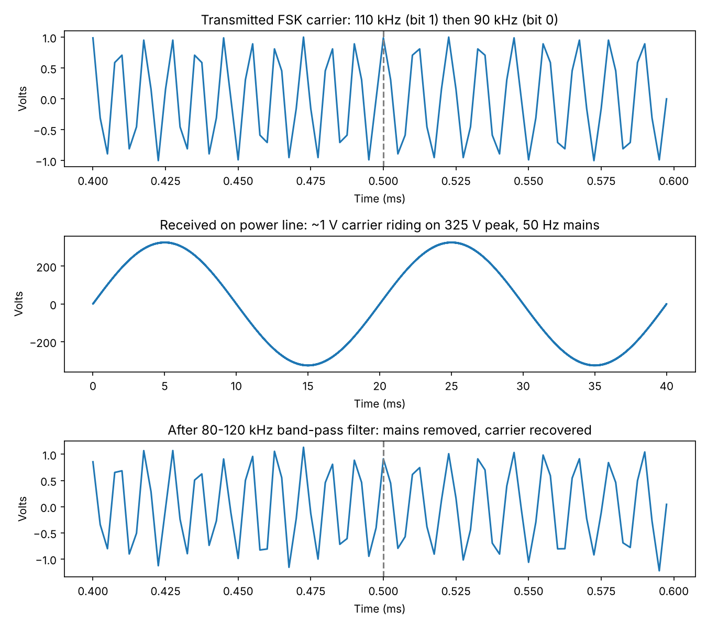
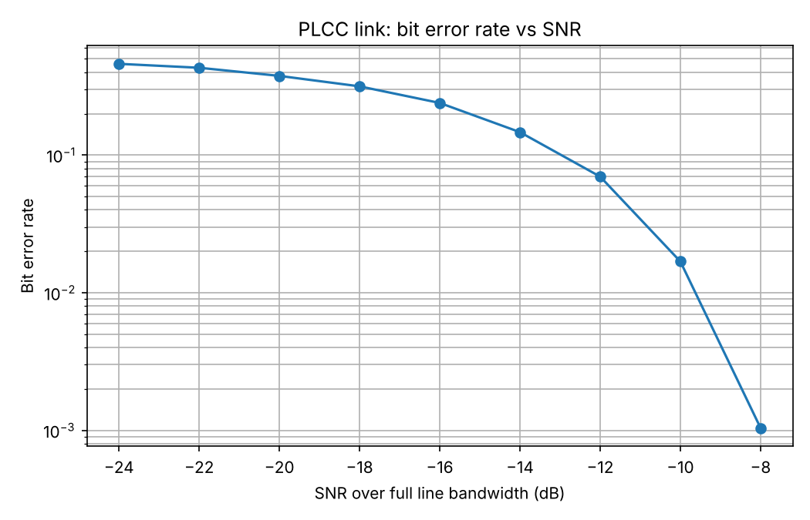

# Substation Monitoring using Power Line Carrier Communication (PLCC)

A Python simulation of a PLCC link that sends substation monitoring data over a power line to a control room, where it raises fault alarms.

**Author:** Rachana Santhebachahalli Umesha · Personal project, 2026

## What it does

```
Substation sensors ──► Packet ──► FSK modulator ──► Power line ──► Band-pass ──► FSK          ──► Control room
(temp, V, I, battery)   encoder    90/110 kHz       (50 Hz mains     filter        demodulator      alarms
                                                     + noise)        80–120 kHz
```

1. **Sensors:** transformer oil temperature, line voltage (11 kV), line current and 110 V DC station battery voltage.
2. **Packet:** each reading becomes a 16-bit word. Each packet is an 8-bit preamble, 64 data bits and an 8-bit checksum.
3. **Modulation:** continuous-phase FSK at 2 kbit/s, 90 kHz for a 0 and 110 kHz for a 1, in the narrowband PLC carrier band.
4. **Channel:** the ~1 V carrier rides on 230 V RMS (325 V peak) 50 Hz mains, plus Gaussian noise at a chosen SNR.
5. **Receiver:** an 80–120 kHz Butterworth band-pass filter removes the mains. Two tone filters and energy detectors then decide each bit.
6. **Control room:** the receiver checks the checksum and raises alarms for over-temperature (>95 °C), voltage outside 10–12 kV, over-current (>400 A) and low battery (<105 V).

## Results

**Normal operation and a fault, at 10 dB SNR:** both packets arrive intact with a valid checksum. The fault packet raises `HIGH transformer_temp_C = 102.4` and `LOW battery_voltage_V = 101.8`. Full output is in [results.txt](results.txt).



The band-pass filter strips out the 325 V mains and recovers the 1 V carrier, with the switch from 110 kHz to 90 kHz visible at the bit boundary.



| SNR (dB, full 0–200 kHz bandwidth) | Bit error rate |
| --- | --- |
| −24 | 0.461 |
| −16 | 0.239 |
| −12 | 0.070 |
| −10 | 0.017 |
| −8 | 0.001 |

SNR is measured across the whole line bandwidth. The receiver only looks at a narrow band around each tone, so it gains a lot of processing gain and still decodes reliably below 0 dB. In an earlier wider sweep, no errors were seen from −5 dB upward.

## Run it

```bash
pip install -r requirements.txt
python plcc_simulation.py
```

## Possible next steps

- Add forward error correction (for example a Hamming code) and compare the BER curves
- Model impulse noise from switching events and frequency-selective line attenuation
- Build it on hardware with a PLC modem module and an Arduino at each end
